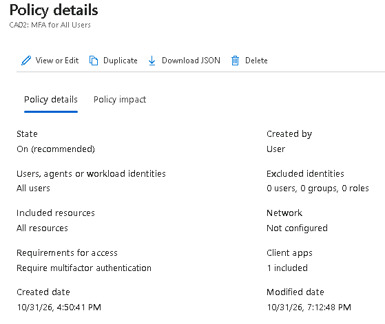
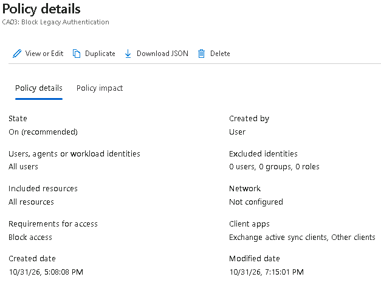
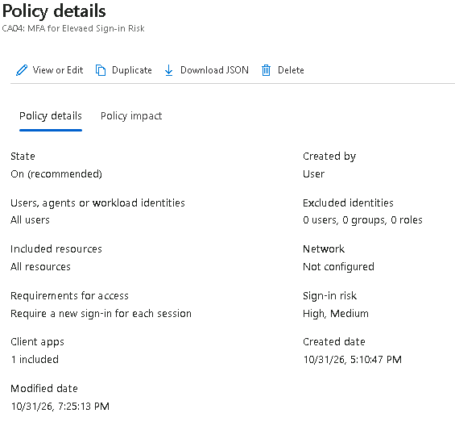
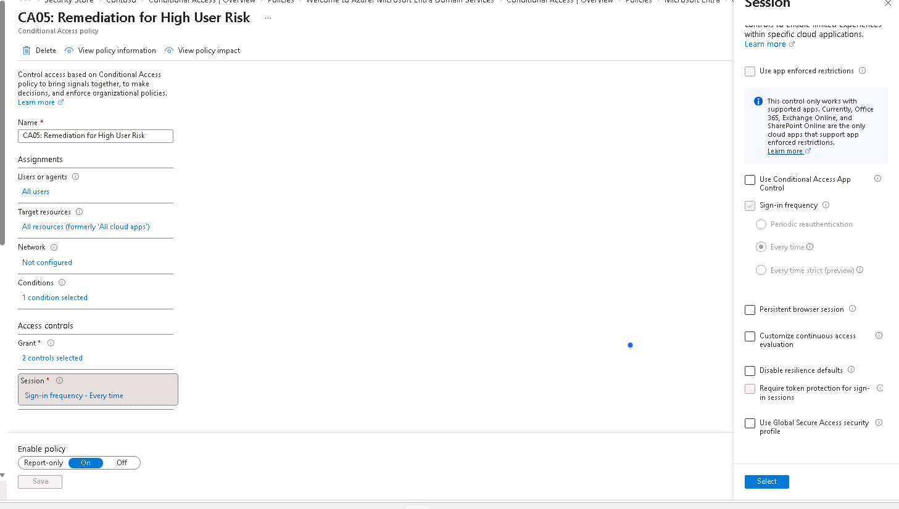
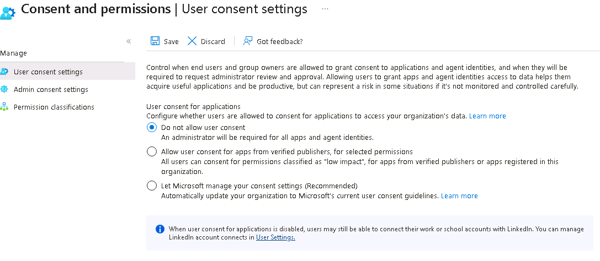
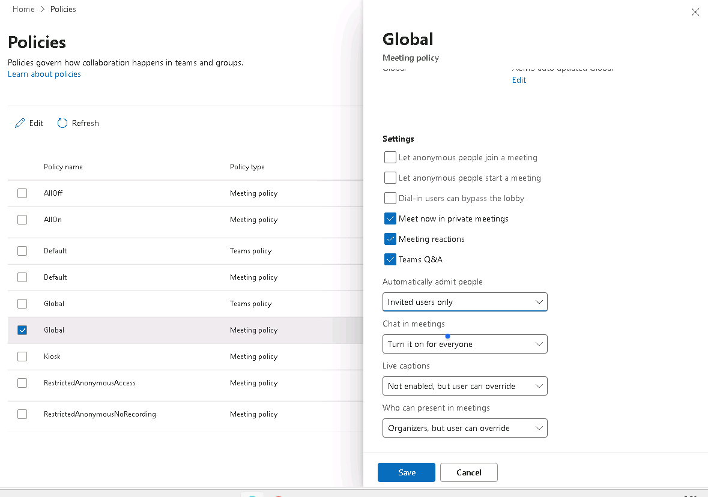
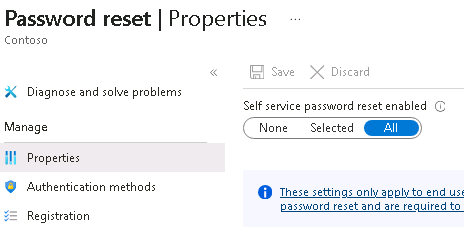
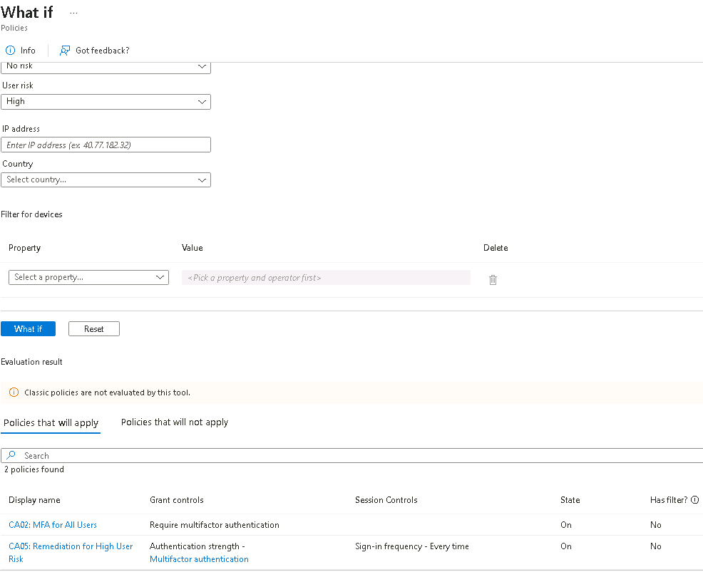

# Microsoft 365 Tenant Security Hardening and Control Validation (Artifact 3)
I participated in Microsoft’s Defend the Tenant event. I understood the security objectives of the event, but I needed additional practice translating those requirements into configurations within the Microsoft Entra interface. Microsoft supplied the lab environment, security-control requirements, and assessment script. I personally navigated the administrative portals, configured the tenant controls, ran the assessment, reviewed the results, corrected configurations, used Conditional Access What If, and inspected policy JSON during troubleshooting. 
Microsoft Copilot helped explain unfamiliar Conditional Access concepts, interpret assessment output, map written requirements to portal settings, recommend a lower-permission method for running the supplied script, and troubleshoot a remaining discrepancy involving the high user-risk remediation policy. I completed the requested tenant configurations.
The supplied assessment confirmed most controls, including all-user and administrator MFA, legacy-authentication blocking, sign-in-risk protection, user-consent restrictions, Teams meeting controls, and tenant-wide SSPR. The high user-risk remediation policy continued to be reported as not configured even though the portal, Conditional Access What If result, and downloaded policy JSON showed the specified targeting, remediation, authentication-strength, and every-time reauthentication settings. I preserved the discrepancy as a troubleshooting finding rather than having the supplied validator modified by Copilot.
## Controls 1-6 and 10 were carried out in Microsoft Entra Admin Center. I started them all in Report-only mode and excluded my admin account pending testing. Once I ran the validator script and failed the checkpoints, I removed my exclusion and, per Copilot’s recommendation, enabled each policy one by one before doing additional tests.
### Controls 01+02 “Multifactor authentication for administrative roles” and “CA02: MFA for All Users”
I created one policy to cover controls 1 and 2 to increase account security across the tenant. I assumed that creating two controls would be redundant. Copilot verified that it would be and pointed me back to Microsoft’s own instructions stating that one control could be used to satisfy both conditions.

### Control 03 “CA03: Block Legacy Authentication”
I created a policy to block less secure legacy authentication for all users. I had to learn the steps as they were different than in my other artifacts on my website.

### Control 04 “CA04: MFA for Elevated Sign-in Risk”
I created a policy requiring MFA for Medium- or High-risk sign-ins, with reauthentication required every time.

### Control 05 “CA05: Remediation for High User Risk”
I created a policy to require remediation and MFA for users with High risk every time they sign in. “Require risk remediation” requires that “Sign-in frequency” be set to “Every time” and that “Target resources” is set to “All resources (formerly ‘All cloud apps’)”. It also requires that MFA be used. Microsoft recommends doing that under the new “Require authentication strength” setting. The supplied validator continued to report this control as not configured. During troubleshooting, I inspected the policy JSON with Copilot and confirmed that the visible configuration appeared to contain the settings required by the validator. I did not establish the root cause before the lab environment expired, so I preserved the discrepancy rather than altering the supplied validator.

### Control 06 “Prevent Ordinary-user Application Consent”
I changed the user-consent setting under Enterprise applications → Consent and permissions to “Do not allow user consent,” preventing ordinary users from independently granting applications access to organizational data on their behalf.

## Controls 7-9 were carried out in Global (Org-wide default) in Microsoft 365 Admin Center
### Control 07 “Invited Participant Teams Lobby Bypass”
I configured the Global meeting policy so that only invited users automatically bypass the lobby; other participants subject to the lobby must be admitted.
### Control 08 “Organizer-only Default Teams Presenters”
The specified “Only organizers and co-organizers” wording was not available in the administrative interface. I selected “Organizers, but user can override,” the most restrictive presenter option available. I then verified through the supplied assessment that the underlying “OrganizerOnlyUserOverride” value satisfied the checkpoint.

### Control 09 “Prevent Anonymous Teams Meeting Join”
I disabled ‘Anonymous users can join a meeting,’ preventing anonymous participants from joining meetings governed by the Global policy.
### Control 10 “Self-service Password Reset for All Users”
I enabled self-service password reset for All users under Entra ID → Password reset → Properties, allowing users to perform supported password-reset operations without relying entirely on administrator intervention.

## Lessons Learned
I learned that I need much more experience navigating the Microsoft Admin centers. I spent a decent amount of time looking for where to change policies compared to actually changing them. I also need to familiarize myself more with Microsoft’s version of “Who, what, when, where, and how?” when configuring Conditional Access: identities, target resources, conditions, grant controls, and session controls. It was interesting to see that a validator could report a failure even though the visible policy configuration appeared to meet the stated requirements. I learned to verify both my configurations and the validator by examining the underlying evidence.

<ul>
  <li><a href="https://www.ezras.work">Return to Main Page</a></li>
</ul>
